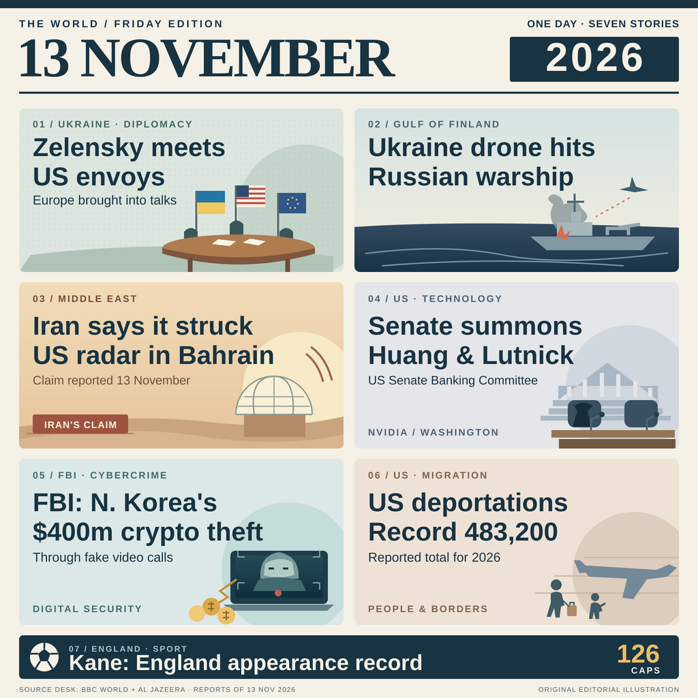

# The World — 13 November 2026

Satu gambar editorial asli yang merangkum tujuh laporan dunia bertanggal 13 November 2026 dari sumber yang disebut kit resmi `news-image-01`. **Dibangun dan diverifikasi secara lokal; belum dipublikasikan atau dikirim ke make.fun.**



## Jalankan

Memerlukan **Node 22**, pustaka standar saja. Tidak ada instalasi, akses jaringan, renderer, atau font yang diperlukan saat runtime.

```sh
MAKEFUN_OUTPUT_DIR=out node main.ts
```

Tanpa variabel tersebut, program menulis `/output/entry.png`, sesuai kontrak grader. Jalur aset dihitung dari `__dirname`, sehingga direktori kerja bebas. `main.ts` memakai CommonJS dan sintaks JavaScript yang kompatibel dengan Node22, termasuk build yang menonaktifkan type stripping. Program memeriksa magic bytes, ukuran file, dan dimensi sebelum menyalin aset. Keutuhan seluruh PNG diverifikasi oleh uji kontrak.

## Uji

```sh
node --test tests/contract.test.mjs
python3 tools/verify-sandbox.py
```

Uji Node memeriksa semua CRC chunk, IHDR/IEND, panjang data gambar terdekompresi, filter baris PNG, batas ukuran/dimensi, kesamaan aset, penulisan dari CWD lain, dua hasil byte-identik, dan penolakan aset rusak. Uji ditulis lebih dahulu dan pertama kali gagal karena entrypoint belum dibuat. Uji penolakan aset rusak juga diperlihatkan gagal sebelum validasi ditambahkan.

Skrip sandbox memakai bubblewrap Linux, root sementara, `/bot` hanya-baca, `/output` writable, namespace jaringan terisolasi, UID/GID 65534, satu CPU, batas proses 64, dan timeout 60 detik. Host ini tidak mempunyai Docker; pemeriksaan bukan reproduksi persis image Docker resmi dan tidak memasang cgroup memori 512 MiB. Peak RSS diukur dan diperiksa terhadap batas tersebut. Hasil terakhir disimpan di [verification/sandbox.json](verification/sandbox.json).

## Sumber dan desain

- [SOURCES.md](SOURCES.md): pemetaan setiap panel ke ringkasan kit dan URL berita, termasuk batas verifikasi. Berita mengikuti sumber kit tersegel; artikel asal tidak diambil melalui jaringan. Tidak ada klaim verifikasi independen.
- [artwork/news.svg](artwork/news.svg): seluruh ilustrasi dan tipografi asli dalam bentuk yang dapat diedit.
- [artwork/DESIGN.md](artwork/DESIGN.md): keputusan komposisi dan revisi visual.
- [artwork/preview-300.png](artwork/preview-300.png): thumbnail yang benar-benar diperiksa dengan vision.
- [VERIFICATION.md](VERIFICATION.md): ringkasan pengujian, batas yang terpenuhi, serta batas pemeriksaan lokal.

Enam panel mencakup diplomasi Ukraina, kapal perang di Teluk Finlandia, klaim Iran tentang radar AS di Bahrain, panggilan Senat terhadap Huang dan Lutnick, laporan FBI tentang pencurian kripto Korea Utara, dan deportasi AS. Pita olahraga mencatat rekor penampilan Kane. Klaim Iran diatribusikan, angka deportasi ditandai sebagai total 2026, dan angka berita tidak diubah. Ini cakupan sumber kit awal hari, bukan daftar lengkap seluruh berita dunia pada akhir hari.

## Bangun ulang aset (opsional, hanya pengembangan)

```sh
node tools/render.mjs
convert entry.png -resize 300x300 -strip artwork/preview-300.png
```

Jalur build memerlukan Python 3, system librsvg/Cairo, ImageMagick, serta font Liberation Sans/Serif. `tools/render-svg.py` memakai ctypes ke pustaka sistem untuk render 2048px; ImageMagick menurunkannya ke PNG RGB 8-bit 1024px dan menghapus metadata waktu. Alat ini hanya untuk mengubah ilustrasi; entrypoint penilaian tidak menjalankannya. Rebuild pada versi renderer/font lain dapat mengubah raster. Hash aset tercatat di `artwork/entry.sha256`.

Kode, ilustrasi, dan tata letak asli: **MIT, Copyright (c) 2026 Arybil**. Referensi berita milik penerbit masing-masing. `.makefun/owner.json` mencantumkan dompet pemilik yang diberikan. Tidak ada API key, credential, transcript buatan, paket runtime, atau remote Git.
